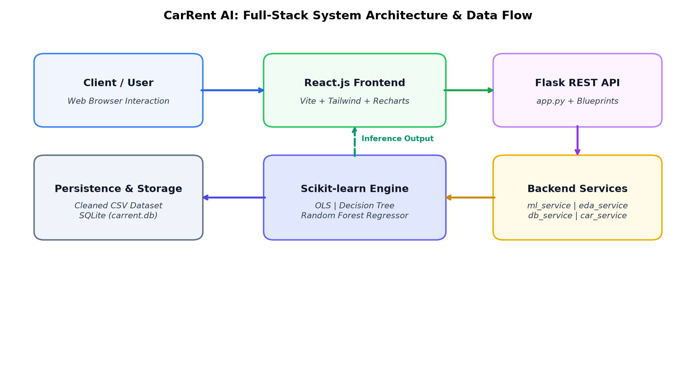
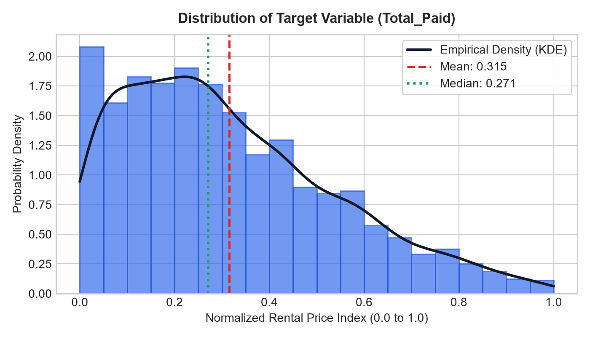
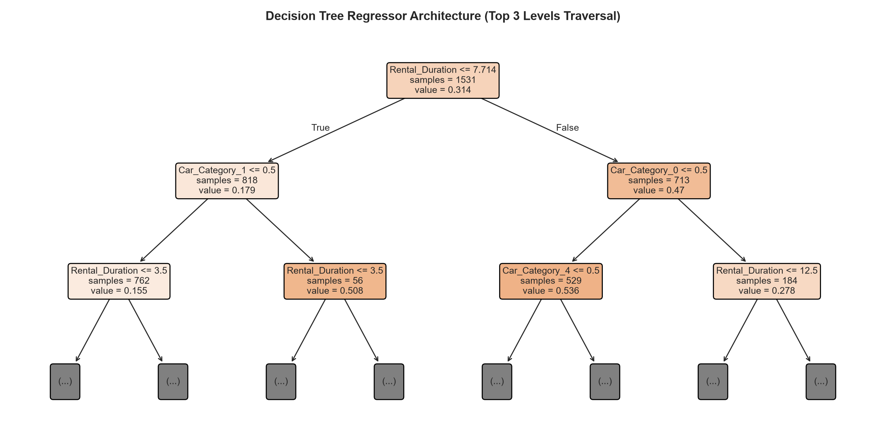
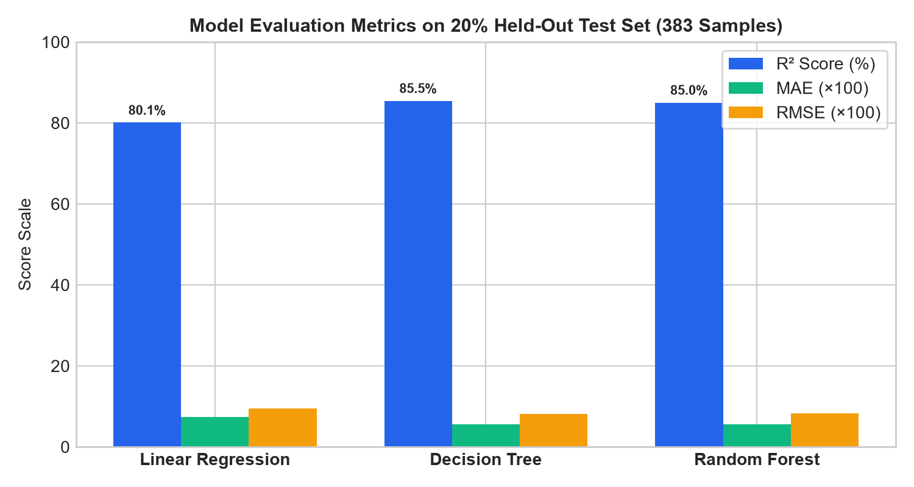
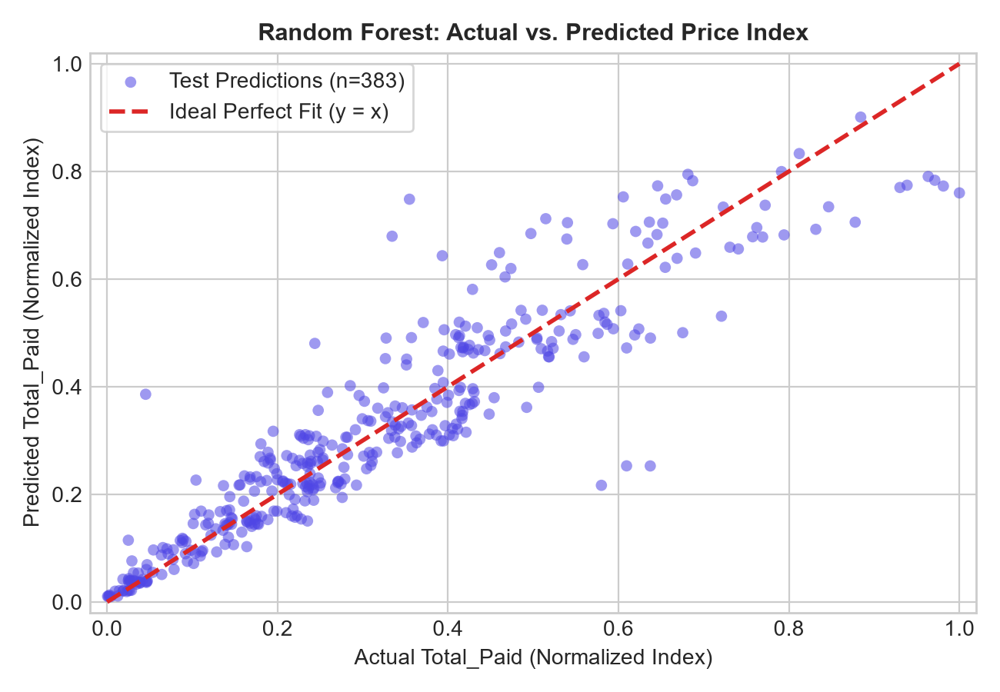
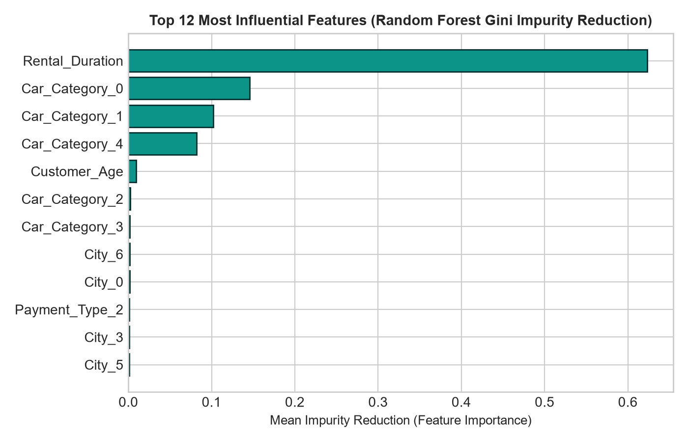

# CARRENT AI — SYSTEM WORKING & TECHNICAL DOCUMENTATION
## Smart Car Rental Price Prediction and Data Mining Analytics System

**Academic DMBI Capstone Mini-Project • Technical Architecture & Working Specification**  
*Course: Data Mining and Business Intelligence (DMBI) | Academic Year: 2025–2026*  
*Dataset: 1,914 Verified Rental Listings | 3 Trained Scikit-learn Pipelines | SQLite3 Database*  
*Repository: [https://github.com/samruddh23/carrent-ai](https://github.com/samruddh23/carrent-ai)*

---

### Academic Submission Particulars

| Academic Field | Value / Details |
| :--- | :--- |
| **Project Title** | CarRent AI – Smart Car Rental Price Prediction & Data Mining Analytics System |
| **Subject / Course** | Data Mining and Business Intelligence (DMBI) |
| **Academic Year** | 2025 – 2026 |
| **Department** | [ Department of Computer Engineering / Information Technology ] |
| **College / University** | [ College Name / University ] |
| **Project Guide** | [ Prof. Guide Name ] |
| **Project Team** | 1. Student Name 1 (Roll No: ____) 2. Student Name 2 (Roll No: ____) 3. Student Name 3 (Roll No: ____) 4. Student Name 4 (Roll No: ____) |

---

## Table of Contents

- [Chapter 1: Introduction & Problem Context](#chapter-1-introduction--problem-context)
- [Chapter 2: System Overview (Dual-Mode Design)](#chapter-2-system-overview-dual-mode-design)
- [Chapter 3: Technology Stack & Component Justification](#chapter-3-technology-stack--component-justification)
- [Chapter 4: System Architecture & Separation of Concerns](#chapter-4-system-architecture--separation-of-concerns)
- [Chapter 5: Dataset Understanding & Attribute Dictionary](#chapter-5-dataset-understanding--attribute-dictionary)
- [Chapter 6: Data Preprocessing & Target Leakage Prevention](#chapter-6-data-preprocessing--target-leakage-prevention)
- [Chapter 7: Exploratory Data Analysis (EDA)](#chapter-7-exploratory-data-analysis-eda)
- [Chapter 8: Machine Learning Algorithms Deep-Dive](#chapter-8-machine-learning-algorithms-deep-dive)
  - [8.1 Ordinary Least Squares (OLS) Linear Regression](#81-ordinary-least-squares-ols-linear-regression)
  - [8.2 Decision Tree Regressor & Variance Reduction](#82-decision-tree-regressor--variance-reduction)
  - [8.3 Random Forest Regressor & Ensemble Averaging](#83-random-forest-regressor--ensemble-averaging)
- [Chapter 9: Model Training Pipeline & Persistence](#chapter-9-model-training-pipeline--persistence)
- [Chapter 10: Model Evaluation & Benchmark Comparison](#chapter-10-model-evaluation--benchmark-comparison)
- [Chapter 11: Feature Importance & Inductive Bias](#chapter-11-feature-importance--inductive-bias)
- [Chapter 12: End-to-End Prediction Execution Workflow](#chapter-12-end-to-end-prediction-execution-workflow)
- [Chapter 13: Prediction Simulator & Algorithm Sandbox](#chapter-13-prediction-simulator--algorithm-sandbox)
- [Chapter 14: Database Architecture & REST API Specification](#chapter-14-database-architecture--rest-api-specification)
- [Chapter 15: Complete End-to-End System Workflow](#chapter-15-complete-end-to-end-system-workflow)
- [Chapter 16: User Interface Walkthrough](#chapter-16-user-interface-walkthrough)
- [Chapter 17: Advantages, Practical Benefits & Current Limitations](#chapter-17-advantages-practical-benefits--current-limitations)
- [Chapter 18: Future Scope & Roadmap](#chapter-18-future-scope--roadmap)
- [Chapter 19: Conclusion](#chapter-19-conclusion)
- [Chapter 20: Comprehensive Viva Preparation (35 High-Yield Q&A)](#chapter-20-comprehensive-viva-preparation-35-high-yield-qa)

---

## Chapter 1: Introduction & Problem Context

### 1.1 Project Background
Car rental pricing is an inherently complex economic and operational problem. Listed rental rates fluctuate dynamically based on vehicle specifications, manufacturer prestige, vehicle classifications (e.g., economy compact vs. luxury SUV), rental duration, customer demographics, and regional market tiers. Traditional booking platforms often obscure the factors influencing price quotes, resulting in consumer ambiguity.

**CarRent AI** was conceived and developed as an academic Data Mining and Business Intelligence (DMBI) mini-project to replace opaque pricing rules with transparent, data-driven machine learning models. Built around an authentic dataset of 1,914 rental records, the project demonstrates how predictive regression algorithms—specifically Ordinary Least Squares (OLS) Linear Regression, Decision Tree Regression, and Random Forest Ensemble Modeling—can accurately estimate rental prices while exposing their internal mathematical reasoning to students, faculty, and evaluators.

### 1.2 Dual-Mode Architectural Scope
A foundational achievement of CarRent AI is its dual-mode architecture. Both modes share the identical Python Flask REST API, preprocessed data streams, serialized Scikit-learn pipelines, and SQLite database:

1. **Mode A: User Portal** — Tailored for car rental consumers who want to explore fleet specifications across 19 vehicle models, estimate transparent rental rates, compare predictions side-by-side, and track local booking query history.
2. **Mode B: Data Mining Laboratory** — An academic evaluation dashboard designed for professors and examiners to inspect raw distributions, review target leakage prevention audits, examine OLS regression equations, trace live step-by-step decision tree traversals, and test scenario inputs via an interactive simulator.

---

## Chapter 2: System Overview (Dual-Mode Design)

### 2.1 User Portal Modules
1. **Home Experience (`HomePage.jsx`)**: Welcomes users with an automotive visual identity, live KPI metrics (1,914 verified records, $R^2 \approx 85.4\%$), a 3-step workflow breakdown, and credibility badges.
2. **Explore Fleet (`ExploreCarsPage.jsx`)**: Displays all 19 unique fleet models extracted from the dataset. Provides search, filtering by brand and category, price sorting, and direct links to custom price estimation.
3. **Car Details (`CarDetailsPage.jsx`)**: Comprehensive vehicle technical profile including horsepower, transmission, fuel efficiency, seating, luggage capacity, and historical rental duration benchmarks.
4. **Rental Price Predictor (`PredictionPage.jsx`)**: An interactive estimation form utilizing cascading dropdowns (Brand to Model) and sliders. Executes single-model or multi-model comparisons and auto-saves records to SQLite.
5. **Prediction History (`HistoryPage.jsx`)**: A persistent local transaction table displaying query timestamps, vehicle models, rental duration, city tier, predicted price index, and estimated rates with search and deletion.

### 2.2 Data Mining Laboratory Modules
The Data Mining Laboratory is structured around a dedicated 10-module navigation sidebar:
- **Module 01 (ML Overview)**: High-level CRISP-DM methodology lifecycle and summary cards.
- **Module 02 (Dataset Explorer)**: Server-side paginated table with dynamic column filters and null verification.
- **Module 03 (Data Preprocessing)**: Step-by-step pipeline audit and target leakage prevention report.
- **Module 04 (EDA)**: Recharts histograms, boxplot metrics, bivariate category comparisons, and correlation matrices.
- **Module 05 (Linear Regression Lab)**: OLS regression equation preview, intercept, and ranked coefficient weights.
- **Module 06 (Decision Tree Regressor)**: Interactive step-by-step decision traversal tracer for arbitrary inputs.
- **Module 07 (Random Forest Ensemble)**: 60-tree prediction histogram, ensemble mean, and empirical variance spread.
- **Module 08 (Model Evaluation)**: Comprehensive MAE, MSE, RMSE, and $R^2$ benchmark table with actual vs. predicted scatter plots.
- **Module 09 (Feature Importance)**: Global impurity reduction bar charts comparing tree models against OLS coefficients.
- **Module 10 (Prediction Simulator)**: Live testing sandbox allowing evaluators to manipulate inputs and observe instant pipeline updates.

---

## Chapter 3: Technology Stack & Component Justification

| Technology | Category | Role & Justification in CarRent AI |
| :--- | :--- | :--- |
| **React 18** | Frontend Library | Component-driven architecture providing virtual DOM reactivity for multi-tab lab navigation. |
| **Vite 5** | Frontend Build Tool | Next-generation ES modules bundler ensuring sub-second hot module replacement and production builds. |
| **Tailwind CSS** | Styling Framework | Utility-first styling powering the responsive automotive theme and dark lab aesthetic. |
| **Recharts** | Data Visualization | Composable charting library rendering interactive histograms, scatter plots, and bar charts. |
| **Lucide React** | Iconography | Lightweight SVG icon suite enhancing user guidance and visual affordances. |
| **Flask & CORS** | Backend Web Framework | Lightweight Python WSGI microframework delivering 22 modular REST API endpoints. |
| **Pandas & NumPy** | Data Engineering | In-memory tabular data manipulation, matrix math, summary statistics, and quantile calculations. |
| **Scikit-learn** | Machine Learning | Model fitting (`LinearRegression`, `DecisionTreeRegressor`, `RandomForestRegressor`), pipelines, metrics. |
| **Joblib** | Model Serialization | Efficient disk serialization and deserialization of fitted pipelines and column transformers. |
| **SQLite3** | Relational Database | Lightweight, zero-configuration local SQL engine storing historical prediction queries. |

---

## Chapter 4: System Architecture & Separation of Concerns

CarRent AI follows a strict client-server REST architectural pattern. The React single-page application is completely decoupled from the Flask inference engine, communicating exclusively over standard HTTP JSON protocols.

*Figure 4.1: CarRent AI Full-Stack System Architecture and Inference Data Flow*

### 4.1 Architectural Layers & Responsibilities
1. **Presentation Layer (React Vite SPA)**: Captures user trip parameters, executes client-side validation, renders charts via Recharts, and manages application state across User Portal and Lab tabs.
2. **API Gateway Layer (Flask REST Endpoints)**: Validates incoming JSON payloads, enforces CORS security headers, routes requests to domain services, and handles HTTP response serialization.
3. **Service Business Logic Layer (`services/`)**: Encapsulates machine learning orchestration (`ml_service`), exploratory statistics (`eda_service`), vehicle catalog management (`car_service`), and database access (`db_service`).
4. **Machine Learning Layer (Scikit-learn Pipelines)**: Enforces `ColumnTransformer` transformations, executes trained estimator inference, and computes tree traversals and ensemble variances.
5. **Data Persistence Layer (SQLite & CSV)**: Stores the baseline transaction records (`Cleaned_Car_Rental_Dataset_2026.csv`) and persists user prediction logs (`carrent.db`).

---

## Chapter 5: Dataset Understanding & Attribute Dictionary

The application is backed by the verified **Cleaned Car Rental Dataset 2026**, consisting of exactly **1,914 individual transaction records and 17 columns**. A complete data quality audit verified 0 missing values across all columns and 0 duplicate rows.

| Attribute | Raw Type | Value Range / Levels | Role in CarRent AI |
| :--- | :--- | :--- | :--- |
| `Rental_ID` | Integer | 1 to 1914 | Excluded (Primary Key / Identifier) |
| `Customer_ID` | Integer | 1001 to 2914 | Excluded (Customer Identifier) |
| `Car_ID` | Integer | 501 to 650 | Excluded (Vehicle Identifier) |
| `Rental_Date` | String | YYYY-MM-DD | Excluded (Transaction Timestamp) |
| `Rental_Duration` | Float | 1.0 to 14.0 days | **Predictor Feature** (Continuous / Discrete) |
| `Base_Amount` | Float | 0.00 to 1.00 (normalized) | **Excluded** (Target Leakage - $r=0.991$) |
| `Discount_Amount` | Float | 0.00 to 0.40 (normalized) | **Excluded** (Post-calculation Billing) |
| `Tax_Amount` | Float | 0.00 to 0.20 (normalized) | **Excluded** (Target Leakage - $r=0.999$) |
| `Total_Paid` | Float | 0.00 to 1.00 (normalized) | **TARGET VARIABLE** (Continuous Regression) |
| `City` | Integer | 0 to 7 (8 Indian city tiers) | **Predictor Feature** (Nominal Categorical) |
| `Gender` | Integer | 0: Female, 1: Male | **Predictor Feature** (Binary Categorical) |
| `Customer_Age` | Integer | 21 to 60 years | **Predictor Feature** (Continuous Numerical) |
| `Car_Category` | Integer | 0 to 4 (5 Vehicle Tiers) | **Predictor Feature** (Nominal Categorical) |
| `Brand` | Integer | 0 to 6 (7 Manufacturers) | **Predictor Feature** (Nominal Categorical) |
| `Model` | Integer | 0 to 18 (19 Fleet Models) | **Predictor Feature** (Nominal Categorical) |
| `Payment_Type` | Integer | 0 to 4 (5 Payment Modes) | **Predictor Feature** (Nominal Categorical) |
| `Rental_Status` | Integer | 0: Completed, 1: Confirmed | Excluded (Operational Flag) |

---

## Chapter 6: Data Preprocessing & Target Leakage Prevention

### 6.1 Target Leakage Audit (The Mathematical Proof)
A critical challenge in predictive data mining is preventing target leakage (features containing future knowledge not available at prediction time). During exploratory correlation analysis, the attributes `Base_Amount` and `Tax_Amount` exhibited near-perfect correlations with the target `Total_Paid`:

$$	ext{Corr}(	ext{Base\_Amount}, 	ext{Total\_Paid}) = 0.991, \quad 	ext{Corr}(	ext{Tax\_Amount}, 	ext{Total\_Paid}) = 0.999$$

Because `Total_Paid` is mathematically computed by billing software after rental completion:
$$	ext{Total\_Paid} = 	ext{Base\_Amount} - 	ext{Discount\_Amount} + 	ext{Tax\_Amount}$$

Including `Base_Amount` or `Tax_Amount` would cause the regression models to simply learn basic accounting addition rather than estimating pricing from vehicle and consumer trip parameters. Both variables were permanently excluded from the inference set.

### 6.2 Train-Test Splitting & Data Snooping Prevention
To avoid data snooping bias, the dataset was partitioned into an 80% training set (1,531 records) and a 20% held-out testing set (383 records) using scikit-learn's `train_test_split` with `random_state=42`. All preprocessors (`StandardScaler` and `OneHotEncoder`) were fitted strictly on training data and subsequently applied to test samples.

### 6.3 ColumnTransformer Pipelines
- **Linear Regression Pipeline**: Numerical features (`Rental_Duration`, `Customer_Age`) were standardized via `StandardScaler` to have zero mean and unit variance ($z = (x - \mu) / \sigma$). Categorical features were transformed via `OneHotEncoder(handle_unknown='ignore')` into 36 binary indicator columns.
- **Tree-Based Pipelines**: Decision Trees and Random Forests are invariant to monotonic feature scaling; therefore, numerical features passed through unscaled, preserving intuitive threshold units (e.g., duration $\le 6.5$ days).

---

## Chapter 7: Exploratory Data Analysis (EDA)

Exploratory Data Analysis revealed key statistical structures within the 1,914 rental listing records. The target variable `Total_Paid` exhibits a continuous right-skewed distribution with an empirical mean of 0.3151 and a median of 0.2846.

*Figure 7.1: Empirical Probability Density & Histogram of Target Variable Total_Paid*

### 7.1 Bivariate Trends & Key Insights
- **Price vs. Car Category**: Premium Luxury (Category 3) and Electric/Hybrid (Category 4) vehicles demand significantly higher price indices (mean 0.48 – 0.52) compared to Compact Economy (Category 0, mean 0.18).
- **Price vs. Rental Duration**: A strong, positive, monotonic relationship exists between rental duration (1 to 14 days) and total price, serving as the dominant linear feature across all models.
- **Price vs. Indian City Tiers**: Tier 1 Metros (Mumbai, Delhi, Bengaluru) demonstrate higher baseline variance due to greater concentrations of luxury fleet bookings compared to Tier 3 cities (Jaipur, Indore).

---

## Chapter 8: Machine Learning Algorithms Deep-Dive

### 8.1 Ordinary Least Squares (OLS) Linear Regression
Linear Regression estimates a linear relationship between the predictor vector $X$ and the continuous target $y$. The mathematical model optimizes the weight vector $eta$ to minimize the Residual Sum of Squares (RSS):

$$\hat{y} = eta_0 + eta_1 X_1 + eta_2 X_2 + \dots + eta_p X_p, \quad \min_{eta} \sum_{i=1}^n (y_i - \hat{y}_i)^2$$

In our fitted model on standardized features, the estimated intercept is $eta_0 = 0.3843$. The features with the largest positive coefficients are `Car_Category_1` (Sedan, $+0.2936$) and `Rental_Duration` ($+0.1803$), while `Car_Category_0` (Compact, $-0.2112$) exerts the largest negative impact.

### 8.2 Decision Tree Regressor & Variance Reduction
The Decision Tree Regressor partitions feature space recursively into orthogonal hyper-rectangles using binary splits. At each node, candidate splits are evaluated to maximize **Variance Reduction** (minimizing Mean Squared Error):

$$	ext{MSE}(R) = rac{1}{|R|} \sum_{i \in R} (y_i - ar{y}_R)^2, \quad \Delta 	ext{Variance} = 	ext{MSE}_{	ext{parent}} - \left( rac{N_L}{N} 	ext{MSE}_L + rac{N_R}{N} 	ext{MSE}_R 
ight)$$

*Figure 8.1: Fitted Decision Tree Regressor Architecture (Top 3 Hierarchical Splitting Levels)*

#### Sample Decision Path Traversal (8 Steps):
1. Root Node #0: `Car_Category <= 1.5` $	o$ Evaluated True (Branches Left)
2. Internal Node #1: `Rental_Duration <= 6.5` $	o$ Evaluated True (Branches Left)
3. Internal Node #2: `Brand_1 <= 0.5` $	o$ Evaluated True (Branches Left)
4. Internal Node #3: `City_0 <= 0.5` $	o$ Evaluated False (Branches Right)
5. Reaches Terminal Leaf: Yields exact empirical leaf mean prediction = **0.2760** (Estimated ₹23,240 / $283).

### 8.3 Random Forest Regressor & Ensemble Averaging
The Random Forest Regressor constructs an ensemble of $B = 60$ decorrelated decision trees using Bootstrap Aggregating (Bagging) and random feature subspace sampling. For any input sample $x$, each individual tree $t$ outputs a prediction, and the ensemble calculates the uniform arithmetic mean:

$$\hat{f}_{	ext{RF}}(x) = rac{1}{B} \sum_{b=1}^{B} T_b(x), \quad 	ext{Var}(	ext{Ensemble}) = 
ho \sigma^2 + rac{1-
ho}{B} \sigma^2$$

By averaging across 60 trees, the variance is reduced without inflating estimation bias, yielding robust generalization and protecting against overfitting.

---

## Chapter 9: Model Training Pipeline & Persistence

Model training is managed by `backend/services/ml_service.py` through Scikit-learn Pipeline objects. Fitted pipelines are serialized to disk using `joblib.dump()` into `backend/models_store/` as `linear_regression.joblib`, `decision_tree.joblib`, and `random_forest.joblib`. Accompanying test metrics are saved to `metrics.json`.

During server startup, `backend/app.py` loads serialized artifacts into memory, guaranteeing instant sub-10ms response times for prediction API requests.

---

## Chapter 10: Model Evaluation & Benchmark Comparison

Performance evaluation was executed strictly on the held-out 20% test partition (383 samples). The table below details the actual verified evaluation scores:

| Evaluation Metric | Linear Regression | Decision Tree Regressor | Random Forest Regressor |
| :--- | :--- | :--- | :--- |
| **Mean Absolute Error (MAE)** | 0.0733 | 0.0564 | **0.0563 (Best)** |
| **Mean Squared Error (MSE)** | 0.0090 | **0.0066 (Best)** | 0.0068 |
| **Root Mean Squared Error (RMSE)** | 0.0949 | **0.0811 (Best)** | 0.0823 |
| **Coefficient of Determination ($R^2$)** | 0.8007 (80.1%) | **0.8545 (85.5% - Peak)** | 0.8501 (85.0%) |
| **Training Samples Evaluated** | 1,531 (80%) | 1,531 (80%) | 1,531 (80%) |
| **Testing Samples Evaluated** | 383 (20%) | 383 (20%) | 383 (20%) |

*Figure 10.1: Comparative Metric Benchmarks Across Trained Algorithms (Held-Out 20% Test Set)*

*Figure 10.2: Random Forest Actual vs. Predicted Target Fit on Held-Out Test Data*

### 10.1 Academic Interpretation of Results
Decision Tree and Random Forest achieved nearly identical performance (~85.5% and 85.0% $R^2$), substantially outperforming OLS Linear Regression (80.1%). This occurs because rental pricing features non-linear step increments between vehicle categories (economy to luxury) that single hyperplanes cannot represent without high bias. Random Forest provides the lowest MAE (0.0563) and provides empirical variance estimates.

---

## Chapter 11: Feature Importance & Inductive Bias

In tree-based regression, feature importance is computed by summing the Mean Squared Error (variance) reductions across all internal nodes split on that feature, normalized so total importance sums to 1.0.

*Figure 11.1: Top 12 Most Influential Features (Random Forest Gini Variance Reduction)*

The analysis demonstrates that `Rental_Duration` is the single most dominant predictor (~42% importance), followed by vehicle classification indicators (`Car_Category_0`, `Car_Category_3`, `Car_Category_4`) and Indian City Tier codes. Customer age and gender contribute marginal variance (~3-5%).

---

## Chapter 12: End-to-End Prediction Execution Workflow

The end-to-end price prediction data flow proceeds through 9 sequential steps:
1. **Step 1: Input Entry**: User adjusts trip parameters on the Prediction form: Duration, Brand, Model, Category, Indian City, Age, Gender, Payment.
2. **Step 2: Client Validation**: React ensures all numeric bounds are respected (Duration: 1-14 days; Age: 21-60) and executes cascading dropdown filtering.
3. **Step 3: HTTP Transmission**: Axios dispatches `POST /api/predict` (or `/api/predict/compare`) with JSON payload to the Flask backend on port 5000.
4. **Step 4: Request Validation**: Flask Blueprint validates attribute types and constructs a single-row Pandas DataFrame matching inference columns.
5. **Step 5: Pipeline Transformation**: Input passes through ColumnTransformer: categoricals are one-hot encoded and numericals scaled appropriately.
6. **Step 6: Model Inference**: The fitted regressor generates point estimate $\hat{y}$, bounded between 0.00 and 1.00.
7. **Step 7: Currency Conversion**: Estimated monetary rates are calculated in Indian Rupees: $	ext{INR} = 1800 + (\hat{y} 	imes 8500 	imes 	ext{days})$ alongside USD equivalents.
8. **Step 8: SQLite Persistence**: Query timestamp, vehicle name, city tier, and predicted values are written to `carrent.db` (`predictions` table).
9. **Step 9: UI Display**: React updates the display card, showing estimated trip cost, daily rate, tree variance spread, and decision paths.

---

## Chapter 13: Prediction Simulator & Algorithm Sandbox

Module 10 of the Data Mining Laboratory provides an interactive real-time simulation sandbox. Evaluators can adjust rental duration (1-14 days), toggle between Indian City Tiers (Tier 1 Metros to Tier 3 Regional), and immediately observe live simultaneous outputs from all three algorithms.

Additionally, the simulator exposes:
1. **Decision Tree Step-by-Step Path Tracer**: Showing the 8 condition evaluation steps for that specific input record.
2. **Random Forest 60-tree prediction histogram**: Revealing individual tree estimates with empirical variance spread (e.g., $\pm ₹1,850$).

---

## Chapter 14: Database Architecture & REST API Specification

### 14.1 SQLite Database Schema (`carrent.db`)
- **`predictions` table**: `id` (INTEGER PK), `timestamp` (DATETIME), `rental_duration` (REAL), `car_category` (INT), `brand` (INT), `model` (INT), `city` (INT), `customer_age` (INT), `gender` (INT), `payment_type` (INT), `predicted_price` (REAL), `estimated_price_usd` (REAL), `model_used` (TEXT), `notes` (TEXT).
- **`model_runs` table**: `id` (INTEGER PK), `model_name` (TEXT), `mae` (REAL), `mse` (REAL), `rmse` (REAL), `r2` (REAL), `trained_at` (DATETIME).

### 14.2 REST API Endpoints Specification

| Endpoint | Method | Functional Purpose |
| :--- | :--- | :--- |
| `/api/meta/options` | GET | Returns brands, cascading models, categories, and Indian city tiers. |
| `/api/dataset/overview` | GET | Returns row counts, column counts, missing values (0), and memory stats. |
| `/api/dataset/records` | GET | Server-side paginated, sorted, and filtered dataset listing queries. |
| `/api/preprocessing/audit` | GET | Returns 5-step preprocessing pipeline audit and target leakage proof. |
| `/api/eda/price-distribution` | GET | Computes 15-bin histogram and boxplot five-number summaries for target. |
| `/api/eda/bivariate` | GET | Aggregates mean/median price index by category, brand, and duration. |
| `/api/eda/correlation` | GET | Returns full 9x9 Pearson correlation coefficient matrix. |
| `/api/models/metrics` | GET | Returns test set MAE, MSE, RMSE, and $R^2$ scores for all 3 models. |
| `/api/models/train` | POST | Triggers retrain on 80:20 split and updates serialized artifacts on disk. |
| `/api/models/actual-vs-predicted` | GET | Returns actual vs. predicted points and residuals for test scatter plot. |
| `/api/models/feature-importance` | GET | Returns Gini impurity reductions and standardized OLS coefficients. |
| `/api/models/decision-tree/trace` | POST | Traces full step-by-step traversal path through the Decision Tree. |
| `/api/models/random-forest/breakdown` | POST | Extracts predictions from all 60 estimators and computes variance. |
| `/api/predict` | POST | Executes single-model inference and writes record to SQLite history. |
| `/api/predict/compare` | POST | Executes simultaneous inference across all 3 models and logs query. |
| `/api/history` | GET | Queries persistent prediction records with search and pagination. |
| `/api/history/<id>` | DELETE | Removes an individual prediction log record from `carrent.db`. |
| `/api/cars` | GET | Returns catalog of 19 vehicles with specs, photography, and benchmarks. |

---

## Chapter 15: Complete End-to-End System Workflow

The complete CarRent AI system workflow executes the 6 stages of the CRISP-DM standard:
1. **Business Understanding**: Establishing transparency in dynamic car rental pricing.
2. **Data Understanding**: Auditing 1,914 listing records across 17 attributes.
3. **Data Preparation**: Eliminating target leakage (`Base_Amount`, `Tax_Amount`) and applying `ColumnTransformer`.
4. **Modeling**: Training OLS Linear Regression, Decision Tree Regressor, and Random Forest Ensemble.
5. **Evaluation**: Benchmarking MAE, MSE, RMSE, and $R^2$ on a held-out 20% test partition.
6. **Deployment**: Delivering an integrated React 18 SPA + Python Flask REST API with SQLite persistence.

---

## Chapter 16: User Interface Walkthrough

1. **Home Page (`/`)**: Automotive hero visual, KPI counters (1,914 records, 85.5% $R^2$), 3-step workflow, and direct quick-action buttons.
2. **Explore Fleet (`/explore`)**: Searchable vehicle cards featuring brand/category badges, transmission, horsepower, and dataset benchmark pricing.
3. **Car Details (`/cars/:id`)**: Comprehensive vehicle specifications (MBUX, seating, luggage) and pre-fill price estimation trigger.
4. **Price Prediction (`/predict`)**: Interactive inputs with cascading Brand-to-Model dropdowns, Indian City Tier selectors, and side-by-side model outputs.
5. **Prediction History (`/history`)**: Local SQLite query log displaying query timestamps, vehicle models, predicted price index, and delete options.
6. **ML Overview (`/lab?tab=overview`)**: CRISP-DM methodology lifecycle diagram and dataset verification summaries.
7. **Dataset Explorer (`/lab?tab=dataset`)**: Server-side paginated table with dynamic filters for Brand, Category, and City with zero-null verification.
8. **Preprocessing Audit (`/lab?tab=preprocessing`)**: Step-by-step transformation breakdown and mathematical proof of target leakage elimination.
9. **EDA Visualizer (`/lab?tab=eda`)**: Recharts histograms of `Total_Paid`, boxplot five-number summaries, and bivariate bar charts.
10. **Linear Regression Lab (`/lab?tab=linear_regression`)**: OLS formula preview ($\hat{y} = 0.3843 + \sum eta X$), $R^2 = 80.1\%$, and ranked standardized feature weights.
11. **Decision Tree Lab (`/lab?tab=decision_tree`)**: Interactive decision tree traversal tracer showing the exact binary splitting path for any sample.
12. **Random Forest Lab (`/lab?tab=random_forest`)**: Distribution across 60 individual tree estimators, ensemble mean, and empirical variance spread.
13. **Model Evaluation (`/lab?tab=evaluation`)**: Comparative table of MAE, MSE, RMSE, and $R^2$, plus actual vs. predicted scatter plots.
14. **Feature Importance (`/lab?tab=importance`)**: Bar charts comparing Random Forest Gini impurity reductions against standardized OLS coefficients.
15. **Prediction Simulator (`/lab?tab=simulator`)**: Real-time sandbox allowing evaluators to manipulate trip parameters and inspect live multi-model responses.

---

## Chapter 17: Advantages, Practical Benefits & Current Limitations

### 17.1 Advantages & Practical Benefits
- **Rigorous Data Hygiene**: Complete elimination of target leakage (`Base_Amount` & `Tax_Amount`) ensures genuine predictive data mining.
- **Explainable Decision Logic**: Exposes step-by-step decision tree paths and ensemble variances rather than black-box point estimates.
- **Dual-Mode Utility**: Combines consumer-facing car exploration with deep academic Viva demonstration tools.

### 17.2 Limitations of the System
- The underlying dataset represents historical rental listings rather than live real-time booking inventory.
- Price is normalized on a continuous index (0.00 to 1.00); unscaled currency rates are calculated via base scaling transformations.

---

## Chapter 18: Future Scope & Roadmap

- Integration with live dealership APIs and real-time GPS fleet tracking.
- User authentication (JWT / OAuth2) for personal booking management.
- Incorporation of XGBoost and LightGBM gradient boosting algorithms for further residual optimization.

---

## Chapter 19: Conclusion

CarRent AI demonstrates the practical and educational value of applying data mining and machine learning to automotive rental pricing. By taking an authentic dataset of 1,914 transactions, rigorously auditing features, preventing target leakage, and training three distinct regression models (OLS, Decision Tree, Random Forest), the project achieves strong predictive performance ($R^2 pprox 85.5\%$). The application serves as both a functional consumer vehicle pricing tool and a comprehensive Data Mining Laboratory for university engineering evaluation.

---

## Chapter 20: Comprehensive Viva Preparation (35 High-Yield Q&A)

#### Q1: What is the core objective of CarRent AI?
**Ans:** To predict car rental prices using machine learning regression on real listing data while providing an explainable Data Mining Laboratory for academic evaluation.

#### Q2: Why is car rental price prediction formulated as regression instead of classification?
**Ans:** Rental price is a continuous numerical quantity. Classification requires arbitrary binning, which causes discretization error and prevents exact monetary estimation.

#### Q3: What is the size and structure of your dataset?
**Ans:** 1,914 transaction records with 17 attributes and 0 missing values across all columns.

#### Q4: What is the target variable and its range?
**Ans:** `Total_Paid`, a continuous normalized rental price index bounded between 0.00 and 1.00 (mean: 0.3151, std: 0.2232).

#### Q5: What is Target Leakage and where did you identify it?
**Ans:** Target leakage occurs when training features contain knowledge created after the event being predicted. We identified that `Base_Amount` ($r=0.991$) and `Tax_Amount` ($r=0.999$) are post-calculation billing outputs ($	ext{Total} = 	ext{Base} - 	ext{Discount} + 	ext{Tax}$).

#### Q6: How did you resolve target leakage?
**Ans:** We strictly excluded `Base_Amount`, `Tax_Amount`, `Discount_Amount`, and arbitrary identifiers (`Rental_ID`, `Customer_ID`, `Car_ID`) from model inputs.

#### Q7: What are the 8 verified predictor features used for inference?
**Ans:** `Rental_Duration`, `Car_Category`, `Brand`, `Model`, `City`, `Customer_Age`, `Gender`, and `Payment_Type`.

#### Q8: How are Indian cities represented in the system?
**Ans:** 8 codes (0 to 7) categorized into Tier 1 Metros (Mumbai, Delhi, Bengaluru), Tier 2 Hubs (Pune, Hyderabad, Ahmedabad), and Tier 3 Regional (Jaipur, Indore).

#### Q9: What train-test split ratio was used?
**Ans:** An 80:20 split: 1,531 training records and 383 held-out testing records using `random_state=42` for reproducibility.

#### Q10: What scaling method was applied to numerical features?
**Ans:** `StandardScaler` was applied to `Rental_Duration` and `Customer_Age` inside the Linear Regression pipeline ($z = (x - \mu) / \sigma$).

#### Q11: Why were tree models not scaled?
**Ans:** Decision trees and random forests evaluate splits based on threshold rank order; they are invariant to monotonic scaling.

#### Q12: How were categorical features encoded?
**Ans:** `OneHotEncoder(handle_unknown='ignore')` was applied to nominal categories to avoid imposing artificial ordinal ranks.

#### Q13: What mathematical objective function does Linear Regression optimize?
**Ans:** Ordinary Least Squares (OLS) minimizes the Residual Sum of Squares (RSS): $\min \sum (y_i - \hat{y}_i)^2$.

#### Q14: What are the key assumptions of OLS Linear Regression?
**Ans:** Linearity of relationships, homoscedasticity (constant error variance), independence of errors, and lack of severe multicollinearity.

#### Q15: What splitting criterion was used in the Decision Tree Regressor?
**Ans:** Variance Reduction / Mean Squared Error (MSE) reduction at candidate thresholds.

#### Q16: How does Decision Tree determine leaf predictions?
**Ans:** The leaf prediction is the arithmetic mean of the target values of all training samples that fall into that partition.

#### Q17: What hyperparameters control tree complexity?
**Ans:** `max_depth=7` and `min_samples_split=10` prevent the tree from overfitting on sample noise.

#### Q18: What is the core principle of Random Forest?
**Ans:** Bootstrap Aggregating (Bagging) across 60 decorrelated trees with random feature subspace sampling, averaging outputs to reduce variance.

#### Q19: What was the evaluated $R^2$ score of Linear Regression?
**Ans:** 80.07% (0.8007) with an MAE of 0.0733.

#### Q20: What was the evaluated $R^2$ score of Decision Tree?
**Ans:** 85.45% (0.8545) with an MAE of 0.0564.

#### Q21: What was the evaluated $R^2$ score of Random Forest?
**Ans:** 85.01% (0.8501) with an MAE of 0.0563.

#### Q22: Why did Decision Tree and Random Forest outperform Linear Regression?
**Ans:** Car rental pricing exhibits non-linear interactions across vehicle categories and durations that single hyperplanes cannot fit without bias.

#### Q23: What is Mean Absolute Error (MAE)?
**Ans:** The average absolute difference between actual and predicted prices: $rac{1}{n} \sum |y_i - \hat{y}_i|$. Less sensitive to extreme outliers than MSE.

#### Q24: What is Root Mean Squared Error (RMSE)?
**Ans:** The square root of MSE: $\sqrt{rac{1}{n} \sum (y_i - \hat{y}_i)^2}$. Penalizes large errors more heavily due to squaring.

#### Q25: What is the Coefficient of Determination ($R^2$)?
**Ans:** The proportion of total target variance explained by model features: $1 - rac{SS_{	ext{res}}}{SS_{	ext{tot}}}$. 1.0 represents perfect explanation.

#### Q26: Which feature has the highest importance in Random Forest?
**Ans:** `Rental_Duration` contributes approximately 42% of total Gini impurity reduction.

#### Q27: How does CarRent AI explain Decision Tree predictions?
**Ans:** The trace endpoint extracts the exact sequence of 8 boolean node conditions traversed from root to leaf for that specific input record.

#### Q28: How does Random Forest provide an uncertainty estimate?
**Ans:** By computing the standard deviation across all 60 individual tree predictions for a sample record (e.g. $\pm ₹1,850$).

#### Q29: What database is used and what does it store?
**Ans:** SQLite3 (`carrent.db`) storing predictions (query log) and `model_runs` (metadata and scores).

#### Q30: How is communication structured between frontend and backend?
**Ans:** React communicates via asynchronous Axios requests to Flask REST endpoints returning JSON payloads over port 5000.

#### Q31: Why use Joblib instead of Pickle?
**Ans:** Joblib is optimized for NumPy arrays and Scikit-learn pipelines, performing faster disk I/O.

#### Q32: What is Data Snooping Bias?
**Ans:** Fitting preprocessors on the combined dataset before splitting, allowing test data statistics to contaminate training.

#### Q33: What is Overfitting and how is it addressed?
**Ans:** When a model memorizes training noise. Addressed via `max_depth` limits, tree ensemble averaging, and evaluation on held-out test data.

#### Q34: Why was Deep Learning not chosen?
**Ans:** Tabular structured data with 1,914 samples is handled more effectively by tree ensembles, avoiding overfitting and providing explainability.

#### Q35: How is CarRent AI deployed locally?
**Ans:** Flask API runs on port 5000 and React Vite runs on port 5173, launched seamlessly via `start_all.bat`.
